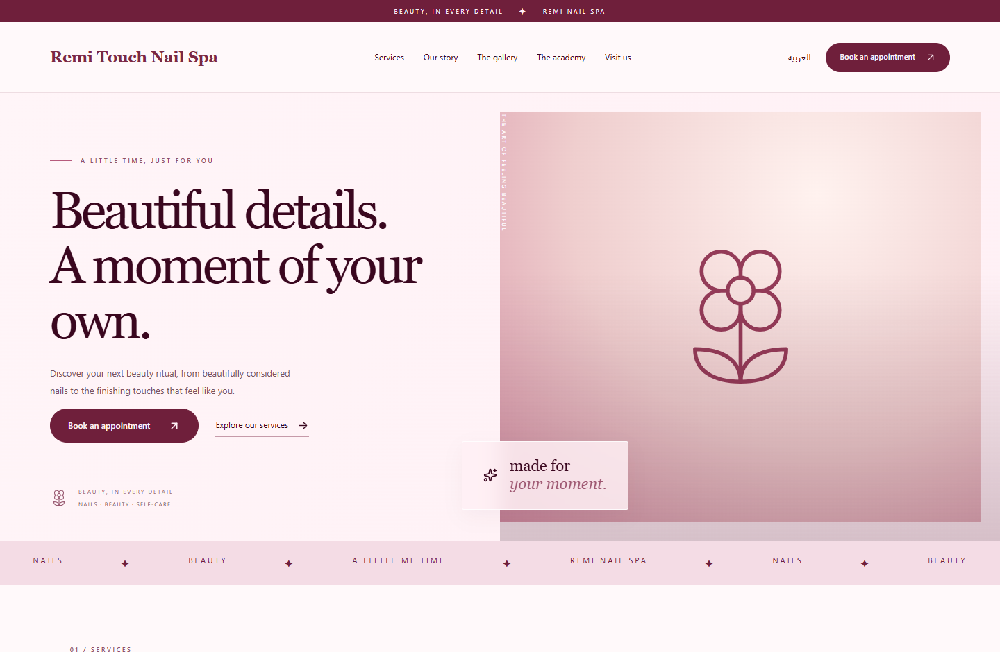
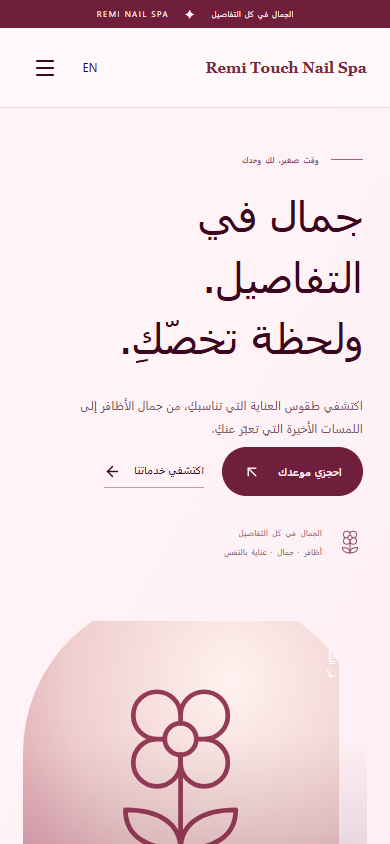

# REMI Touch Nail Spa

An English and Arabic salon booking and administration platform. Guests can browse services, book appointments, and register for academy courses. A single owner manages availability, bookings, content, and catalog settings from a private dashboard.

## Screenshots

The screenshots show this portfolio edition using an empty demonstration catalog. The desktop view is in English. The mobile view is in Arabic with right-to-left layout.

| English desktop | Arabic mobile |
| --- | --- |
|  |  |

## Features

- Guest appointment booking, cancellation, and rescheduling using time-limited management access.
- Shared salon availability with working hours, schedule exceptions, session capacity, and timezone-aware slot calculations.
- Owner dashboard for the booking calendar, appointment history, salon services, academy courses, gallery, and bilingual page content.
- API validation and authorization, idempotent booking requests, and queued notifications.

## Technology

React, TypeScript, React Router, TanStack Query, Tailwind CSS, and Lucide icons power the interface. Laravel and PHP provide the REST API, session authentication, validation, and background jobs. The working project uses MySQL and supports SQLite for isolated tests. See [Architecture](docs/architecture.md) for the booking and availability model.

## Portfolio scope

This is a source-only portfolio edition. Start with `frontend/src/App.tsx` for the public experience, `frontend/src/Admin.tsx` for the dashboard, and `backend/routes/api.php` for the API. The snapshot includes the Laravel dependency lockfile and an environment template with blank secret fields. It omits the frontend install manifests, Vite and Vitest configuration, deployment configuration, generated bundles, and private project data. It does not provide a standalone frontend build or a deployable stack.

The full working project uses Vite and Vitest. Its development dependency tree contains `picomatch` 4.0.7, affected by a high-severity denial-of-service advisory. The affected toolchain is outside this snapshot. The working project's dependency finding remains open. [GitHub advisory](https://github.com/advisories/GHSA-fc5q-39xc-vjpf)

The portfolio uses a text wordmark and original styling in place of the supplied logo and editorial photos. It includes the license notice for the Bootstrap-derived social icons.

## Developer credit

Development and implementation by the REMI Touch Nail Spa project maintainer.
